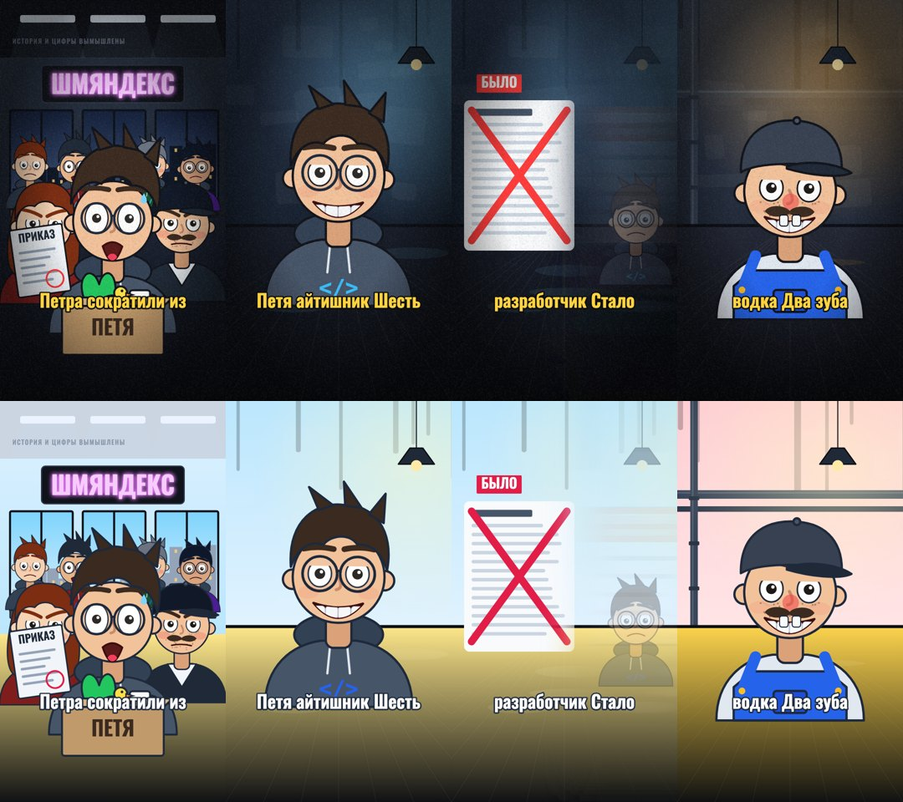

# Мультмашина

Универсальный генератор мультиков и рилсов. Кладёте сценарий, получаете вертикальное видео: герои с лицом, волосами и эмоциями, закадровый голос от нейросети, субтитры по словам, звуковые эффекты. Всё считается у вас на машине, картинка рисуется кодом, а кадры снимает настоящий браузер.



*Один и тот же эпизод в двух стилях. Сверху «Тёмный двор» (зерно, виньетка, неон), снизу «Светлый мультик».*

> **Статус: версия 0.1.** Движок, стили, рендер и озвучка работают, проверено на macOS (Apple Silicon). Озвучка Qwen3-TTS работает только на Apple Silicon, Edge TTS — где есть интернет, Chatterbox перенесён из рабочего скрипта и в этой версии отдельно не прогонялся. Windows не проверялась.

## Что умеет

- **Герои без картинок.** Лицо, брови, зрачки, моргание, слёзы, пот, румянец, лохматые волосы, очки, кепка, сварочная маска, пиджак или комбинезон. 15 готовых эмоций, которые плавно перетекают друг в друга, и превращение героя из одного облика в другой.
- **Стили.** Палитра, шрифты, субтитры, зерно и виньетка, комнаты и офис настраиваются YAML-файлом. Один эпизод снимается в разных стилях флагом `--стиль`.
- **Голос нейросетью.** Бэкенды на выбор: Qwen3-TTS (голос «заказывается» описанием, потом клонируется на весь эпизод), Chatterbox, Edge TTS. Речь ускоряется без смены высоты, паузы сжимаются, громкость выравнивается.
- **Точная синхронизация.** В тексте ставите метки `[[имя]]` перед словами, на которые должна «попасть» картинка. Локальный Whisper находит время каждого слова: отсюда метки и субтитры, которые идут ровно под голос.
- **Детерминированный рендер.** Любой кадр рисуется как функция от времени, поэтому видео получается одинаковым при каждом запуске и снимается параллельно в нескольких браузерах. На M1 Max эпизод в 52 секунды снимается за минуту.
- **По-русски всё.** Конфиги с русскими ключами, ошибки и подсказки по-русски. Опечатка в ключе даёт понятное сообщение, а не молчаливо теряется.

## Быстрый старт

Нужны: macOS или Linux, [uv](https://docs.astral.sh/uv/), ffmpeg и Chromium для Playwright.

```bash
git clone https://github.com/jointime1/multmashina.git
cd multmashina
uv run python -m playwright install chromium

# посмотреть пример в браузере (со звуком, пробел — пауза)
uv run python scripts/mm.py смотреть examples/jobturbo

# снять видео: out/jobturbo.mp4 и субтитры out/jobturbo.srt
uv run python scripts/mm.py снять examples/jobturbo

# тот же эпизод в другом стиле
uv run python scripts/mm.py снять examples/jobturbo --стиль light-cartoon
```

Озвучка примера уже лежит в `examples/jobturbo/audio/`, поэтому ставить модели для просмотра и рендера не нужно.

## Эпизод — это папка

```
examples/jobturbo/
  episode.yaml      стиль, герои, озвучка, замены в субтитрах
  narration.yaml    реплики по битам, с метками [[имя]]
  scenes.js         что рисуется в каждом бите
  props.js          свои детали эпизода (необязательно)
  audio/            озвучка и timings.json (делает команда «озвучить»)
```

Минимальный эпизод (вся папка лежит в `tests/fixtures/mini`):

```yaml
# episode.yaml
название: Мини
стиль: dark-yard
скрипты: [scenes.js]
герои:
  петя: {очки: true}
```

```yaml
# narration.yaml
биты:
  один: "[[hi]]Привет, [[w]]мир."
```

```js
// scenes.js
const BEATS = [['один', 'Тест', (m, D) => {
  const p = panel(0), s = shot(p, 0, undefined, { bg: DARK });     // кадр на весь бит
  room(s, 'комната');                                               // фон из стиля
  word(s, 'мир', CX, 600, m('w'), { size: 160, fill: LIGHT });      // слово вылетает, когда звучит «мир»
  hero(s, 'петя', CX, 1000, 1, [[0, 'neutral'], [m('w'), 'grin']], 0, D);   // герой: нейтральный, на «мир» улыбается
  finish(p); caps(p, 'один');                                       // зерно с виньеткой и субтитры
}]];
start(BEATS);
```

`m('метка')` возвращает время слова, `D` — длину реплики. Весь справочник по движку — в [docs/scenes.md](docs/scenes.md).

## Озвучка

```bash
# голос из episode.yaml → audio/*.mp3 + audio/timings.json
uv run --extra voice --extra qwen python scripts/mm.py озвучить examples/jobturbo
# другой бэкенд
uv run --extra voice --extra edge python scripts/mm.py озвучить examples/jobturbo --голос edge
# перегенерировать только часть битов
uv run --extra voice --extra qwen python scripts/mm.py озвучить examples/jobturbo --только hook,outro
```

| Бэкенд | Что это | Где работает |
|---|---|---|
| `qwen-клон` | Qwen3-TTS: клон голоса по эталонной записи, один тембр на весь эпизод | Mac на Apple Silicon |
| `qwen-дизайн` | Qwen3-TTS: голос по текстовому описанию («низкий хриплый мужик лет 55»); каждая реплика получает новый голос, поэтому им подбирают тембр и записывают эталон для клона | Mac на Apple Silicon |
| `chatterbox` | Chatterbox multilingual, голос по умолчанию или клон | PyTorch: mps или cpu |
| `edge` | Edge TTS, готовые голоса Microsoft | где есть интернет |

Как получить свой голос, подробности про темп и метки: [docs/voice.md](docs/voice.md). Qwen и Chatterbox взаимно несовместимы по версиям библиотек: ставьте один из них.

## Стили, герои, комнаты

Стиль — YAML-файл в `styles/`: палитра, шрифты, субтитры, эффекты, комнаты и офис. Герои и комнаты можно описать и прямо в `episode.yaml`: кто играет в эпизоде, относится к эпизоду, а не к стилю. Все ключи — в [docs/styles.md](docs/styles.md).

## Как это устроено

```
narration.yaml ─┐
episode.yaml  ──┼─► озвучить ─► audio/*.mp3 + timings.json ─┐
styles/*.yaml ──┘                                           ├─► собрать ─► build/<эпизод>/ (автономная страница)
scenes.js + engine/ ────────────────────────────────────────┘              │
                                                                    смотреть │ снять
                                                                   (предпросмотр)  (кадры Playwright + звук numpy + ffmpeg → MP4 и SRT)
```

- `engine/` — движок на чистом JavaScript без сборки: ядро (время, анимации), кит (слова, штампы, счётчики, иконки), герои, декорации, субтитры, плеер.
- `scripts/mmlib/` — сборка, рендер, озвучка, синтез эффектов.
- Движок знает, что в каждый момент времени должно быть на экране, и умеет нарисовать любой кадр независимо от остальных: так работают перемотка в предпросмотре и параллельный рендер.

## Ограничения

- Кадр вертикальный 900×1600 (9:16); слова держите в зоне x 50–810, y 130–1290: платформы закрывают остальное своими кнопками.
- Герои рисуются кодом по пояс: гибкие, но это мультяшная графика, а не фотореализм. Новые облики (причёски, одежда) добавляются в `engine/characters.js`.
- Озвучка нейросетью: звук проверять на слух. Один и тот же тембр на все биты гарантирует только клон с эталона.
- Качество и условия моделей — на стороне их авторов; список в [СТОРОННИЕ.md](СТОРОННИЕ.md).

## Разработка

```bash
uv run --extra dev python -m pytest          # 15 тестов, включая проверку детерминизма кадров в Chromium
```

## Лицензия

MIT (файл `LICENSE`). Иконки Phosphor — MIT, шрифт Oswald — SIL OFL, подробности и благодарности — в [СТОРОННИЕ.md](СТОРОННИЕ.md).

Пример `examples/jobturbo` — вымышленная история в формате рекламного рилса сервиса JobTurbo; цифры в ней вымышлены. Название «Шмяндекс» — шутка, к настоящим компаниям отношения не имеет.
